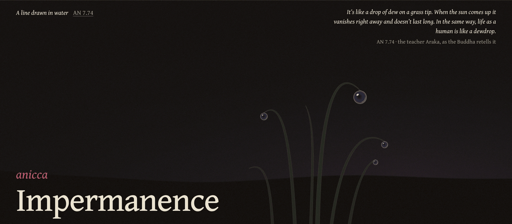

Hi! Here are a few things I've been working on.

## [Shijhon](https://github.com/Jasshl/shijhon)

Brings your own music library and external catalogs together in the music apps you already use, through Navidrome.

## [Dhamma Thread](https://dhamma-thread.jasshl.workers.dev/)

A site for exploring Buddhist concepts through connected pages, reading trails and interactive visualizations.

## ComfyUI tools and workflows

[Local Atelier](https://github.com/Jasshl/Local-Atelier) is a workflow for local image generation and iterative editing, developed for my master's thesis and evaluated with visual artists. I also made a few tools alongside it:

- [Image History](https://github.com/Jasshl/ComfyUI-Image-History) — reuse previous outputs for iterative editing.
- [Text Latch](https://github.com/Jasshl/ComfyUI-Text-Latch) — keep and reuse prompt text across runs.
- [Prompt Viewer](https://github.com/Jasshl/ComfyUI-Prompt-Viewer) — browse generated images and inspect their embedded prompts.
